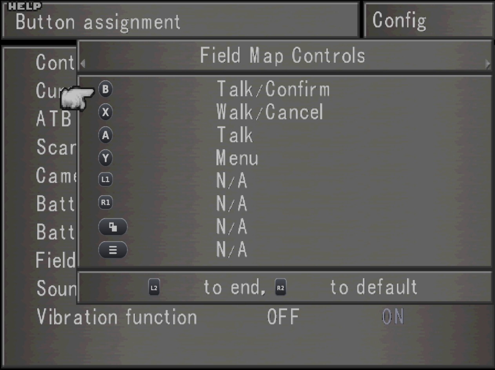

# FF8 Steam Deck Button Glyphs

Shows the **Steam Deck** buttons (A, B, X, Y, L1/R1, L2/R2, View, Menu) wherever **Final Fantasy
VIII** (Steam 2013) names a button, instead of the PC version's "B1", "B2", ... labels. Packaged as a
Junction VIII mod.



- The glyph shown always matches the button the command is bound to in the game's own Config
  screen, so custom bindings are fine.
- Timber train mission: the keypad "diamond" in Rinoa's briefing follows the Deck's layout (Y top,
  X left, B right, A bottom); each code number moves to the button its command is bound to.
- With the keyboard in use, FFNx shows key names as before.

## Requirements

- Final Fantasy VIII, **Steam 2013 edition, English executable** (`FF8_EN.exe`).
- **FFNx** (as installed by Junction VIII). The mod turns on FFNx's `ff8_use_gamepad_icons`.
- Steam Input's default gamepad layout (A bottom, B right, X left, Y top).

## Install

1. Download `FF8DeckGlyphs.iroj` from the [latest release](../../releases/latest).
2. In Junction VIII: **Import mod**, pick the file, activate **FF8 Steam Deck Button Glyphs** in your
   profile and start the game from Junction VIII. J8 warns that the mod contains code
   (`deckglyphs.dll`, the train-diamond fix); that is expected.

**With AxlRose's mod** (UI on): both mods replace the same two icon textures. Place this mod
**above** AxlRose's in the Junction VIII list.

`deckglyphs.dll` writes `deckglyphs.log` into the game folder (hook status and each diamond
rearrangement).

## How it works

- **Icons**: FFNx's `ff8_use_gamepad_icons` draws the PlayStation icon of the physical button bound
  to each command. This mod replaces those icons, on the menu icon pages
  `menu/hires/iconfl01_04.dds` and `iconfl03_04.dds`, with Deck glyphs. Everything on these pages is
  drawn by `tools/make_glyphs.py`; no game art is included.
- **Train diamond**: the briefing is dialogue text with four icon/number pairs. `deckglyphs.dll`
  hooks the call to the text renderer (`0x49FD14`) and reorders the pairs before they are drawn.
  It checks the code bytes first and switches itself off on any other executable.

## Build

Needs clang, lld, llvm (`llvm-dlltool`), Python 3 with Pillow and DejaVu Sans Bold. No game files.

```
tools/release.sh 0.7      # DLL, tests, textures, dist/FF8DeckGlyphs.iroj
```

`tools/bump.sh major|minor|bugfix` raises `<Version>` in `mod/mod.xml` (0.7 -> 0.71 -> 0.8 -> 1.0;
Junction VIII compares versions as decimal numbers, so minor and bugfix are one digit each).

Releases are built by GitHub Actions (`.github/workflows/release.yml`): push an annotated tag
`vX.Y`; its message becomes the release notes.

## License

GPL-3.0, see `LICENSE`. The glyph art is generated by `tools/make_glyphs.py` and covered by the same
license. Steam Deck is a trademark of Valve Corporation; this project is not affiliated with Valve
or Square Enix.
